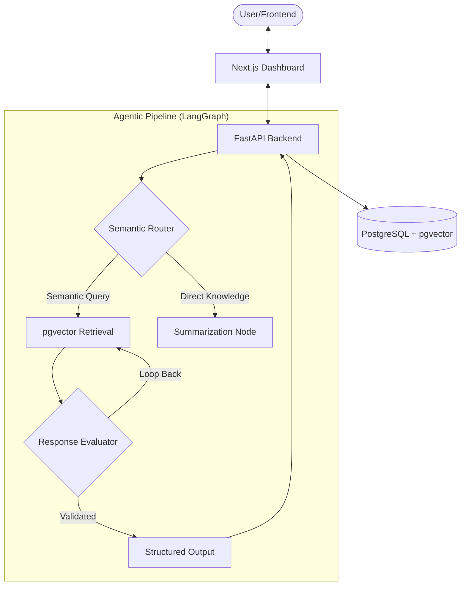

[](https://github.com/unnita1235-code/NexusBase)# NexusBase: Enterprise RAG Architecture

## What I changed

This is a fork of [unnita1235-code/NexusBase](https://github.com/unnita1235-code/NexusBase) (MIT); all original work and credit belong to the upstream author.

- **Corpus:** 39 FastAPI tutorial pages (MIT, Markdown) in [`corpus/`](corpus/), source in [`corpus/SOURCE.txt`](corpus/SOURCE.txt). Ingest via the existing API: `for f in corpus/*.md; do curl -s -F "file=@$f" -F access_level=public http://localhost:8000/v1/ingest; echo; done`
- **Free models:** optional Google AI Studio (Gemini) setup in [`.env.example`](.env.example); also copy `.env` to `backend/.env` (compose reads that path).
- **Fixes:** small startup fixes (missing deps, two broken imports, bcrypt pin, 1536-dim embeddings).
- **Eval harness:** 20 draft questions in [`eval/questions.json`](eval/questions.json). Run `python3 eval/run_eval.py` (stdlib only, stack running); results go to [`eval/results.md`](eval/results.md).
- **Current results:** retrieval hit rate **0.00**, keyword pass rate **0.00** (0/20 each). The first run had no LLM API key, so every query failed before retrieval; re-run once a key is set.
- **Every decision, with alternatives and reasons:** [`DECISIONS.md`](DECISIONS.md).


[](https://nextjs.org/)
[](https://fastapi.tiangolo.com/)
[](https://python.langchain.com/docs/langgraph/)
[](https://github.com/pgvector/pgvector)

## Live Preview

> **Deployment Status:** Frontend is currently being redeployed. Backend API is fully functional. Run locally with Docker — see Quick Start below.

[](https://github.com/unnita1235-code/NexusBase)


> **Note:** Frontend deployment is currently being redeployed. The codebase is complete — see [Architecture](#-architecture) below.


**NexusBase** is a production-grade Retrieval-Augmented Generation (RAG) system designed for enterprise-scale knowledge management. It leverages a modern agentic workflow using LangGraph to handle complex document reasoning, multi-step retrieval, and structured responses.

## 🏗️ Architecture

The system follows a modular, containerized architecture designed for high availability and low latency.



## 🚀 Quick Start (Local Deployment)

NexusBase is fully containerized with Docker. To spin up the entire stack (Dashboard, API, Database, and Workers), run the following command:

### Prerequisites
- Docker & Docker Compose
- OpenAI API Key (or local LLM configuration in `.env`)

### Deployment
```bash
# Clone the repository (if not already local)
# git clone <your-repo-url>
# cd NexusBase

# Initialize environment variables
cp .env.example .env

# Launch the stack
docker compose up --build
```

The services will be available at:
- **Dashboard:** `http://localhost:3000`
- **Backend API:** `http://localhost:8000`
- **Database:** `localhost:5432`

## 🛠️ Tech Stack

- **Frontend:** Next.js 14, TypeScript, Tailwind CSS, Lucide React.
- **Backend:** Python 3.11, FastAPI, Pydantic.
- **Orchestration:** LangGraph, LangChain.
- **Vector Store:** PostgreSQL with `pgvector` extension.
- **DevOps:** Docker, Docker Compose, GitHub Actions.

## 📄 License
This project is licensed under the MIT License.
